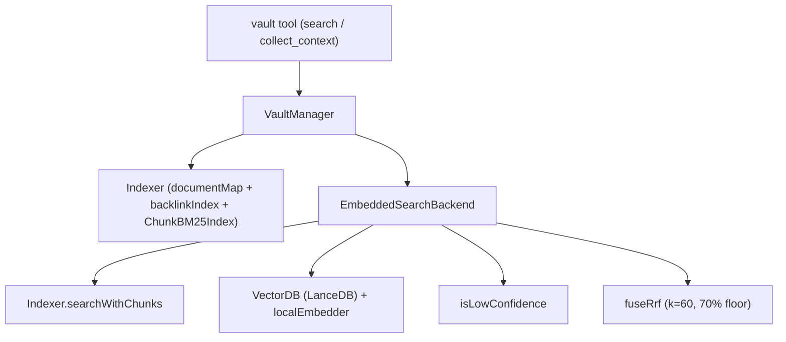

# 로컬 임베디드 검색 개선(`low_confidence` 표시 · 검색 로직 분리) 구현·테스트 명세

이 문서는 Docker나 외부 검색 엔진을 배제하고, ADR 0001(로컬 단독 동작)을 유지한 채 `docs/search-quality-evaluation.md` 4.15~4.17에서 검증한 로컬 임베디드 검색 개선을 운영 코드(`src/`)에 반영하기 위한 설계, 최종 구조, 테스트 기준을 정의한다.

- **대상 1:** 낮은 신뢰도(`low_confidence`) 표시(`dense < 0.88 && bm25 == 0`) 운영 반영. 결과는 버리지 않는다.
- **대상 2:** `VaultManager`에 결합된 검색·융합 로직을 순수 모듈(`scoreFusion.ts`, `lowConfidence.ts`)과 `EmbeddedSearchBackend`로 분리
- **범위 제외:** Docker 기반 Elasticsearch 백엔드 및 외부 HTTP 검색 어댑터

---

## 1. 설계 원칙과 경계

1. **로컬 단독 무의존 유지:** 외부 서버, Docker, 추가 npm 패키지 없이 현재 임베디드 스택(`ChunkBM25Index` + LanceDB + `Xenova/multilingual-e5-small`)만으로 동작한다.
2. **책임 분리:** `VaultManager`는 파일 I/O, 경로 보안 경계, 메타(`documentMap`)·백링크(`backlinkIndex`), 색인 수명주기 조율을 맡고, 검색 점수 계산과 신뢰도 판정은 `src/shared/search-backend/`가 전담한다.
3. **단방향 의존 규칙(`AGENTS.md`):** 새 모듈은 `src/shared/search-backend/`에 두며 `src/tools/`를 import하지 않는다. 소스 코드에는 도구 지시문 외 주석을 쓰지 않는다.
4. **하위 호환 유지:** 기존 `VaultManager.hybridSearch(query, limit)` 시그니처와 `search_status` 응답 계약을 깨지 않고 `reason`에 `"low_confidence"`만 추가한다.

---

## 2. 최종 아키텍처와 파일 구조



### 추가·수정 파일 목록

```text
src/
  config.ts                                   # LOW_CONFIDENCE_DENSE_THRESHOLD 환경변수 추가
  shared/
    searchStatus.ts                           # reason에 "low_confidence" 추가
    search-backend/
      types.ts                                # DenseHit, KeywordHitInput, HybridSearchResult, SearchBackend
      lowConfidence.ts                        # 낮은 신뢰도 판정 순수 함수
      scoreFusion.ts                          # RRF 순수 융합 함수 (k=60, 70% 상대 하한)
      EmbeddedSearchBackend.ts                # 로컬 ChunkBM25 + LanceDB + 신뢰도 판정 + RRF 조합
      index.ts                                # 공개 export
    vault-manager/
      VaultManager.ts                         # hybridSearch를 EmbeddedSearchBackend에 위임
tests/
  unit/
    LowConfidence.test.ts                     # 판정 경계값·폴백 보호 단위 테스트
    ScoreFusion.test.ts                       # RRF 순수 함수 단위 테스트
    EmbeddedSearchBackend.test.ts             # 검색·폴백·신뢰도 표시 통합 동작 테스트
```

---

## 3. 상세 구현 명세

### 3.1 환경변수 계약 (`src/config.ts`)

| 환경변수 | 기본값 | 허용값 / 설명 |
|---|---|---|
| `LOW_CONFIDENCE_DENSE_THRESHOLD` | `0.88` | `0~1` 실수. `0`이면 표시 비활성화 |

- 값이 범위를 벗어나거나 숫자가 아니면 기본값 `0.88`로 안전하게 폴백하고 stderr 경고를 남긴다.

### 3.2 상태 스키마 확장 (`src/shared/searchStatus.ts`)

```ts
export const searchStatusSchema = z.object({
	mode: z.enum(["hybrid", "keyword"]),
	reason: z
		.enum(["models_missing", "semantic_unavailable", "low_confidence"])
		.optional(),
	setup_command: z.string().optional(),
	indexing: z
		.object({
			progress: z.number(),
			processed: z.number(),
			total: z.number(),
		})
		.optional(),
});
```

### 3.3 `SearchBackend` 인터페이스 (`src/shared/search-backend/types.ts`)

```ts
export interface DenseHit {
	filePath: string;
	similarity: number;
	chunk: ChunkMetadata;
}

export interface KeywordHitInput {
	document: DocumentIndex;
	score: number;
	chunk: string | null;
}

export interface SearchBackend {
	search(
		query: string,
		limit: number,
	): Promise<{
		results: HybridSearchResult[];
		searchStatus: SearchStatus;
	}>;
}
```

### 3.4 `low_confidence` 낮은 신뢰도 표시 (`src/shared/search-backend/lowConfidence.ts`)

```ts
export const DEFAULT_LOW_CONFIDENCE_DENSE_THRESHOLD = 0.88;

export interface LowConfidenceInput {
	hasSemanticSearch: boolean;
	topDenseSimilarity: number;
	topBm25Score: number;
	threshold?: number | undefined;
}

export function isLowConfidence(input: LowConfidenceInput): boolean {
	const threshold = input.threshold ?? DEFAULT_LOW_CONFIDENCE_DENSE_THRESHOLD;
	if (threshold <= 0 || !input.hasSemanticSearch) {
		return false;
	}
	return input.topBm25Score === 0 && input.topDenseSimilarity < threshold;
}
```

**결과를 버리지 않는 이유:** 답이 있는 225건 중 1건(`b055`, 최고 유사도 `0.86395`)도 조건에 걸린다. 결과를 비우면 AI는 놓친 정답을 알 수 없어 "노트에 없다"고 답할 수 있다. 무관한 결과는 AI가 읽고 거를 수 있다. `b055`를 살리는 임계값(`0.86395` 이하)에서는 무응답 표시율이 10%(2/20)로 떨어진다.

**핵심 주의점(Gotchas):**
- **키워드 폴백 제외:** 임베더 미설치(`models_missing`) 또는 워밍업 실패(`semantic_unavailable`)로 `hasSemanticSearch === false`일 때는 `topDenseSimilarity`가 `0`이므로 **표시하지 않는다.**
- **코사인 거리 → 유사도 변환:** `VectorDB.search()`는 `_distance`(코사인 거리 = `1 - similarity`)를 반환하므로 `similarity = Math.max(0, Math.min(1, 1 - chunk._distance))`로 변환해 넘긴다.
- **임계값의 모델 종속성:** `0.88`은 `Xenova/multilingual-e5-small`, vault 하나, 무응답 질의 20건에서 고른 값이다. Dense 1위 유사도의 AUROC는 답 있음 224건 측정에서 `0.897`이다(`docs/search-quality-evaluation.md` 4.17). 임베딩 모델을 교체하면 `scripts/eval/compare-algorithms.ts`의 `no_answer Rejection Analysis`로 다시 보정한다.
- **AI의 반응은 미측정:** 도구 설명이 결과를 확인한 뒤 답하라고 안내하지만, AI가 이 표시를 얼마나 따르는지는 재지 않았다.
- **반환 형태:** 결과는 그대로 두고 `search_status: { mode: "hybrid", reason: "low_confidence" }`를 반환한다.

### 3.5 점수 융합 순수 모듈 (`src/shared/search-backend/scoreFusion.ts`)

현재 `VaultManager.ts` 158~222행의 RRF 로직을 상태 없는 순수 함수로 추출한다.

```ts
export const RRF_K = 60;
export const KEYWORD_FUSION_MIN_RELATIVE_SCORE = 0.7;

export function fuseRrf(params: {
	keywordHits: KeywordHitInput[];
	denseHits: DenseHit[];
	resolveDocument: (filePath: string) => DocumentIndex | null;
	limit: number;
}): HybridSearchResult[]
```

- `denseHits.length > 0`일 때만 키워드 1위 점수의 70% 미만 후보를 제외한다(`denseHits`가 비어 있으면 하한을 적용하지 않고 키워드 전체를 보존한다).
- 같은 `filePath`의 Dense 청크는 첫 등장 순위 1번만 RRF 점수에 더하고, 나머지 청크는 `matchedChunks`에 추가한다.
- 벡터 청크가 없는 키워드 단독 매칭 문서는 BM25가 찾은 본문 청크(`keywordChunks`)를 `matchedChunks`에 채운다.

### 3.6 `EmbeddedSearchBackend` (`src/shared/search-backend/EmbeddedSearchBackend.ts`)

`VaultManager`로부터 `indexer`, `safeSemanticSearch` 콜백(또는 `vectorDB`·`localEmbedder`·`localModelManager` 의존성), `lowConfidenceThreshold`를 주입받아 아래 순서로 실행한다.

1. `isLocalAIReady === false`이면 키워드 단독 검색 후 `mode: "keyword", reason: "models_missing"` 반환(`low_confidence` 미표시).
2. `semanticResults = await safeSemanticSearch(query, limit * 3)` 실행.
3. `rawKeywordHits = indexer.searchWithChunks(query, 0)` 실행해 `topBm25Score = rawKeywordHits[0]?.score ?? 0` 확보.
4. `isLowConfidence(...)`로 낮은 신뢰도를 판정.
5. `fuseRrf(...)`로 상위 `limit`개를 계산하고, `semanticResults.length === 0`이면 `mode: "keyword", reason: "semantic_unavailable"`, 아니면 `mode: "hybrid"` 반환(낮은 신뢰도면 `reason: "low_confidence"` 추가).

**주의:** 3단계에서 `rawKeywordHits`를 1회 조회한 뒤 `fuseRrf` 내부에서 70% 상대 하한을 거르도록 통일하면 `Indexer.searchWithChunks`를 두 번 호출하지 않아도 `topBm25Score`와 융합 입력을 동시에 얻을 수 있다.

---

## 4. 테스트 코드 기준

### 4.1 테스트 원칙

- 모든 테스트는 외부 네트워크·모델 다운로드·실제 개인 Vault 없이 `npm test`로 100% 독립 실행되어야 한다.
- 기존 테스트(`HybridSearchKeywordFallback.test.ts`, `VaultSemanticFallback.test.ts`, `SearchDefectRegressions.test.ts`)는 수정 없이 그대로 통과해야 한다.

### 4.2 파일별 필수 테스트 케이스

#### 1) `tests/unit/LowConfidence.test.ts`

| 케이스 | 입력 | 기대 결과 |
|---|---|---|
| 낮은 신뢰도 | `hasSemanticSearch: true`, `topDenseSimilarity: 0.879`, `topBm25Score: 0` | `true` |
| 경계값 허용 | `hasSemanticSearch: true`, `topDenseSimilarity: 0.88`, `topBm25Score: 0` | `false` |
| 높은 유사도 허용 | `hasSemanticSearch: true`, `topDenseSimilarity: 0.91`, `topBm25Score: 0` | `false` |
| 키워드 일치 보호 | `hasSemanticSearch: true`, `topDenseSimilarity: 0.70`, `topBm25Score: 4.5` | `false` |
| 키워드 폴백 보호 | `hasSemanticSearch: false`, `topDenseSimilarity: 0`, `topBm25Score: 0` | `false` |
| 판정 비활성화 | `threshold: 0`, `hasSemanticSearch: true`, `topDenseSimilarity: 0.1`, `topBm25Score: 0` | `false` |

#### 2) `tests/unit/ScoreFusion.test.ts`

- **70% 상대 하한:** Dense 결과가 있을 때 키워드 1위 점수의 70% 미만 문서는 RRF에서 제외된다.
- **시맨틱 폴백 시 하한 해제:** `denseHits`가 빈 배열이면 70% 미만 키워드 문서도 모두 반환된다.
- **중복 청크 처리:** 같은 문서의 Dense 청크가 여러 개여도 RRF 순위 점수는 첫 등장 1회만 가산되고 `matchedChunks`에는 모두 유지된다.
- **키워드 청크 폴백:** 벡터 청크가 없는 키워드 매칭 문서는 `matchedChunks`에 키워드 청크가 채워진다.
- **경계 입력:** 빈 `keywordHits` + 빈 `denseHits` → `[]`, 결과 수는 `limit`을 넘지 않는다.

#### 3) `tests/unit/EmbeddedSearchBackend.test.ts`

- **낮은 신뢰도 표시:** `bm25` 결과가 없고 `vectorDB.search` 최고 청크의 `_distance = 0.15`(`similarity = 0.85 < 0.88`)이면 Dense 결과를 유지하고 `search_status.reason === "low_confidence"`를 반환한다.
- **정상 의미 질의 통과:** `bm25` 결과가 없어도 `_distance = 0.09`(`similarity = 0.91 >= 0.88`)이면 Dense 결과를 정상 반환하고 `search_status.mode === "hybrid"`, `reason === undefined`다.
- **상태 보존:** `models_missing` 및 `semantic_unavailable` 폴백 시 기존과 동일한 `search_status`를 반환하며 `low_confidence`를 표시하지 않는다.
- **`VaultManager.hybridSearch` 패리티:** 리팩터링 전후 동일 입력에 대해 `VaultManager.hybridSearch`가 동일한 문서 순서와 `matchedChunks`를 반환한다.

### 4.3 머지 전 품질·회귀 게이트

| 검증 항목 | 통과 기준 | 명령 |
|---|---|---|
| 포맷 · 린트 | 오류 0건 | `npm run check` |
| 단위 테스트 | 전체 통과(기존 410건 + 신규 테스트) | `npx vitest run` |
| 타입 검사 · 빌드 | 오류 0건 | `npm run build` |
| 검색 품질 회귀 | `golden167` MRR ≥ `0.860`, `blind59 strict` MRR ≥ `0.655` | `npx tsx scripts/eval/compare-algorithms.ts --vault <복사본>` |
| `low_confidence` 회귀 | 답 있음 표시율 ≤ `0.5%`, `no_answer` 표시율 ≥ `50.0%` | 위 명령의 `no_answer Rejection Analysis` |

---

## 5. 권장 구현 순서 (PR 분할)

1. **PR 1 (`low_confidence` 표시):** `lowConfidence.ts` + `config.ts` + `searchStatus.ts` + `VaultManager.ts` 연동 + `LowConfidence.test.ts`.
2. **PR 2 (로컬 검색 로직 분리):** `types.ts` + `scoreFusion.ts` + `EmbeddedSearchBackend.ts` 추출 + `VaultManager.ts` 위임 + `ScoreFusion.test.ts` · `EmbeddedSearchBackend.test.ts`(기존 410개 테스트 및 `compare-algorithms.ts` 수치 동일성 검증).
